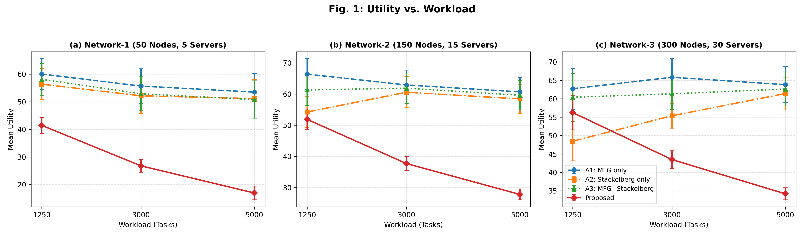
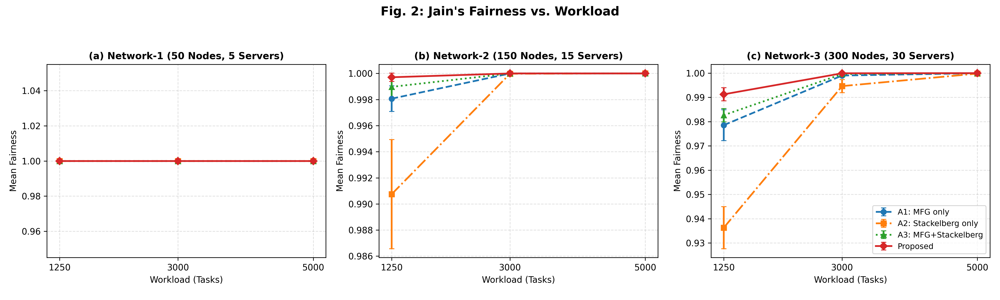
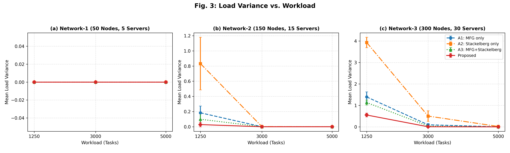
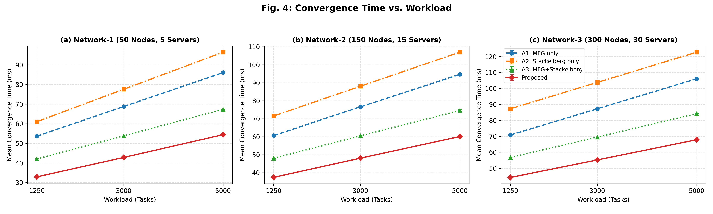
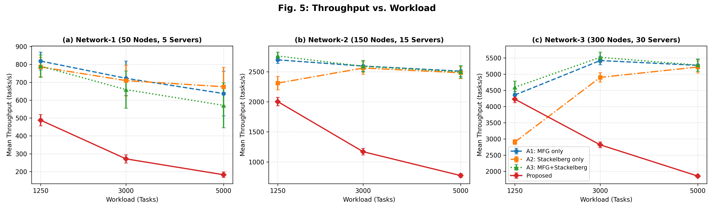
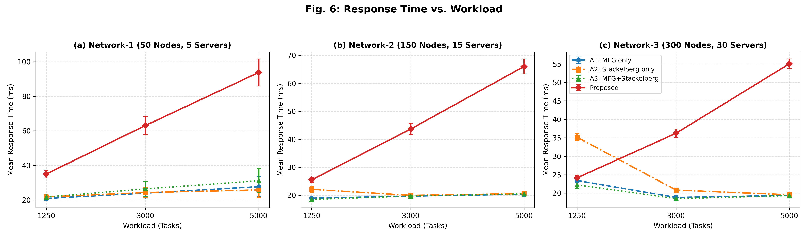

# Experimental Report

## 1. System Architecture & How the Framework Works

This simulation framework models a hierarchical three-tier IoT Edge Computing environment consisting of **IoT Task Generators**, **Edge Nodes** (followers), and **Edge Servers** (leaders). Rather than relying on static heuristics or unverified equilibrium claims, the pipeline executes a five-stage mathematical workflow:

1. **Heterogeneous Topology & Workload Generation (`generator.py`)**:
   - Instantiates three network scales: **Network-1 (Small)** with 50 edge nodes and 5 servers, **Network-2 (Intermediate)** with 150 nodes and 15 servers, and **Network-3 (Stress)** with 300 nodes and 30 servers.
   - Generates task workloads of **1,250**, **3,000**, and **5,000** tasks under three arrival profiles: **T1** (latency-sensitive telemetry), **T2** (balanced mixed IoT traffic), and **T3** (compute/bandwidth-intensive analytics).
2. **Multi-Attribute Priority Classification (`priority.py`)**:
   - Every individual task $i$ is evaluated using a composite priority score $S_i \in [0, 1]$ combining deadline urgency ($45\%$), application criticality ($35\%$), and normalized resource intensity ($20\%$):
     $$S_i = 0.45 \cdot U_i + 0.35 \cdot C_i + 0.20 \cdot I_i$$
   - Tasks are dynamically classified into four priority tiers: **P1** ($S_i \ge 0.70$, weight $1.60$), **P2** ($0.52 \le S_i < 0.70$, weight $1.25$), **P3** ($0.35 \le S_i < 0.52$, weight $1.00$), and **P4** ($S_i < 0.35$, weight $0.75$). Thus, each workload produces a realistic observed distribution of $P_1, P_2, P_3, P_4$ tasks rather than a single static label.
3. **Seven-Rule Resource Feasibility Filtering (`resource_filter.py`)**:
   - Before game-theoretic allocation, candidate edge nodes are filtered against seven strict hardware and QoS constraints: (i) Available CPU $\ge$ task demand, (ii) Available RAM $\ge$ task demand, (iii) Available Storage $\ge$ task demand, (iv) Available Bandwidth $\ge$ task demand, (v) Estimated transmission + queuing latency $\le 50\text{ ms}$, (vi) Projected CPU utilization $\le 85\%$, and (vii) Projected RAM utilization $\le 90\%$.
4. **Hierarchical Game-Theoretic Coordination (`stackelberg.py`, `nash_mfg.py`, `hierarchical_game.py`)**:
   - **Leader Stage (Stackelberg Pricing)**: Each Edge Server $s$ acts as a Stackelberg leader, optimizing its unit resource price $p_s \in [p_{\min}, p_{\max}]$ to maximize server utility (revenue minus cluster congestion penalty) while anticipating the elastic demand response of follower nodes.
   - **Follower Stage (Mean-Field Game Nash Equilibrium)**: Edge Nodes and tasks act as followers. First, damped fixed-point iterations compute the stationary mean-field flow distribution across nodes. Second, tasks are routed sequentially by minimizing a priority-weighted potential cost combining base propagation latency, real-time virtual queue backlog, quadratic utilization congestion, and server pricing.
   - **Ablation Variants**:
     - **A1: MFG only**: Solves the intra-node MFG Nash distribution without Stackelberg pricing feedback or priority ordering.
     - **A2: Stackelberg only**: Optimizes server leader prices and routes tasks by price-proportional weights without intra-node MFG congestion balancing.
     - **A3: MFG+Stackelberg**: Combines Stackelberg pricing and MFG Nash load balancing without task priority differentiation.
     - **Proposed (Priority-Aware MFG + Stackelberg)**: Integrates 7-rule feasibility filtering, $P_1\text{--}P_4$ priority-ordered scheduling, Stackelberg leader pricing, and priority-weighted MFG Nash routing.
5. **Queue-Based Task Execution & Independent Equilibrium Verification (`edge_node.py`, `metrics.py`)**:
   - Tasks are committed to their assigned nodes, advancing each node's `next_available_time_ms` queue clock based on instruction length (MI) and core processing speed (MIPS) to produce genuine turnaround response times and throughput.
   - **Final Nash Gap ($\downarrow$)** is verified independently post-allocation by auditing the maximum relative cost reduction any task could achieve by unilaterally migrating to the least-congested node.
   - **Stackelberg Gap ($\downarrow$)** is verified independently over a fine 60-point price audit grid by measuring the relative leader utility shortfall against the global best-response price.

---

## 2. Experimental Design & Phase-1 Resource Filtering (27 Configurations)

- **Networks evaluated:** Network-1 (50 nodes, 5 servers), Network-2 (150 nodes, 15 servers), Network-3 (300 nodes, 30 servers).
- **Task loads:** 1,250, 3,000, and 5,000 tasks.
- **Task profiles:** T1 (Urgency-heavy), T2 (Balanced), T3 (Compute-heavy).
- **Phase-1 scope:** 27 unique experimental configurations (`E1`–`E27`).
- **Phase-2 scope:** 3 networks $\times$ 3 workloads $\times$ 4 ablation policies $\times$ 9 replications = **324 matched simulation runs** (81 paired conditions across the 4 methods).

### Table 1. Network Configuration and Resource Parameters

| Parameter | Network-1 (Small) | Network-2 (Intermediate) | Network-3 (Stress) |
| --- | --- | --- | --- |
| Edge nodes | 50 | 150 | 300 |
| Edge servers | 5 | 15 | 30 |
| CPU capacity per node | 2–8 cores | 2–8 cores | 2–8 cores |
| RAM per node | 4–16 GB | 4–16 GB | 4–16 GB |
| Storage per node | 64–256 GB | 64–256 GB | 64–256 GB |
| Bandwidth per node | 50–200 Mbps | 50–200 Mbps | 50–200 Mbps |
| Maximum CPU utilization | 85% | 85% | 85% |
| Maximum RAM utilization | 90% | 90% | 90% |
| Maximum latency | 50 ms | 50 ms | 50 ms |
| Load: 1,250 tasks – tasks/node | 25 | 8.33 | 4.17 |
| Load: 3,000 tasks – tasks/node | 60 | 20 | 10 |
| Load: 5,000 tasks – tasks/node | 100 | 33.33 | 16.67 |
| Feasible node count | Dynamic | Dynamic | Dynamic |

### Table 2. Consolidated Seven-Rule Resource Filtering Viability Across Networks and Workloads

| Metric | Eligibility rule | N1 (1,250 / 3,000 / 5,000) | N2 (1,250 / 3,000 / 5,000) | N3 (1,250 / 3,000 / 5,000) |
| --- | --- | --- | --- | --- |
| CPU | Available CPU >= task demand | (100.0% viable) | (100.0% viable) | (100.0% viable) | (100.0% viable) | (100.0% viable) | (100.0% viable) | (100.0% viable) | (100.0% viable) | (100.0% viable) |
| RAM | Available RAM >= task demand | (100.0% viable) | (100.0% viable) | (100.0% viable) | (100.0% viable) | (100.0% viable) | (100.0% viable) | (100.0% viable) | (100.0% viable) | (100.0% viable) |
| Storage | Available storage >= task demand | (100.0% viable) | (100.0% viable) | (100.0% viable) | (100.0% viable) | (100.0% viable) | (100.0% viable) | (100.0% viable) | (100.0% viable) | (100.0% viable) |
| Bandwidth | Available bandwidth >= task demand | (100.0% viable) | (100.0% viable) | (100.0% viable) | (100.0% viable) | (100.0% viable) | (100.0% viable) | (100.0% viable) | (100.0% viable) | (100.0% viable) |
| Latency | Estimated latency <= 50 ms | (100.0% viable) | (100.0% viable) | (100.0% viable) | (100.0% viable) | (100.0% viable) | (100.0% viable) | (100.0% viable) | (100.0% viable) | (100.0% viable) |
| CPU utilization | Projected utilization <= 85% | (99.2% viable) | (100.0% viable) | (100.0% viable) | (99.2% viable) | (99.4% viable) | (99.2% viable) | (99.1% viable) | (99.2% viable) | (99.2% viable) |
| RAM utilization | Projected utilization <= 90% | (100.0% viable) | (100.0% viable) | (100.0% viable) | (100.0% viable) | (100.0% viable) | (100.0% viable) | (100.0% viable) | (100.0% viable) | (100.0% viable) |

### Table 3. Phase-1 Experimental Configurations (E1–E27) with Observed P1–P4 Priority Distributions

| Exp. | Network | Edge Nodes | Servers | Task Load | Tasks/Node | Task Profile | Observed Priority Distribution (P1–P4) | Mean Feasible Nodes |
| --- | --- | --- | --- | --- | --- | --- | --- | --- |
| E1 | N1 | 50 | 5 | 1250 | 25.0 | T1 | P1:115 (9.2%), P2:644 (51.5%), P3:436 (34.9%), P4:55 (4.4%) | 50.0 |
| E2 | N1 | 50 | 5 | 1250 | 25.0 | T2 | P1:46 (3.7%), P2:396 (31.7%), P3:628 (50.2%), P4:180 (14.4%) | 50.0 |
| E3 | N1 | 50 | 5 | 1250 | 25.0 | T3 | P1:6 (0.5%), P2:223 (17.8%), P3:609 (48.7%), P4:412 (33.0%) | 47.9 |
| E4 | N1 | 50 | 5 | 3000 | 60.0 | T1 | P1:280 (9.3%), P2:1585 (52.8%), P3:1002 (33.4%), P4:133 (4.4%) | 50.0 |
| E5 | N1 | 50 | 5 | 3000 | 60.0 | T2 | P1:102 (3.4%), P2:1050 (35.0%), P3:1410 (47.0%), P4:438 (14.6%) | 50.0 |
| E6 | N1 | 50 | 5 | 3000 | 60.0 | T3 | P1:18 (0.6%), P2:495 (16.5%), P3:1453 (48.4%), P4:1034 (34.5%) | 48.9 |
| E7 | N1 | 50 | 5 | 5000 | 100.0 | T1 | P1:476 (9.5%), P2:2605 (52.1%), P3:1677 (33.5%), P4:242 (4.8%) | 50.0 |
| E8 | N1 | 50 | 5 | 5000 | 100.0 | T2 | P1:140 (2.8%), P2:1737 (34.7%), P3:2346 (46.9%), P4:777 (15.5%) | 49.8 |
| E9 | N1 | 50 | 5 | 5000 | 100.0 | T3 | P1:45 (0.9%), P2:774 (15.5%), P3:2364 (47.3%), P4:1817 (36.3%) | 48.6 |
| E10 | N2 | 150 | 15 | 1250 | 8.33 | T1 | P1:133 (10.6%), P2:604 (48.3%), P3:442 (35.4%), P4:71 (5.7%) | 149.7 |
| E11 | N2 | 150 | 15 | 1250 | 8.33 | T2 | P1:33 (2.6%), P2:444 (35.5%), P3:590 (47.2%), P4:183 (14.6%) | 148.5 |
| E12 | N2 | 150 | 15 | 1250 | 8.33 | T3 | P1:10 (0.8%), P2:192 (15.4%), P3:640 (51.2%), P4:408 (32.6%) | 147.6 |
| E13 | N2 | 150 | 15 | 3000 | 20.0 | T1 | P1:253 (8.4%), P2:1618 (53.9%), P3:998 (33.3%), P4:131 (4.4%) | 149.9 |
| E14 | N2 | 150 | 15 | 3000 | 20.0 | T2 | P1:91 (3.0%), P2:1044 (34.8%), P3:1422 (47.4%), P4:443 (14.8%) | 148.4 |
| E15 | N2 | 150 | 15 | 3000 | 20.0 | T3 | P1:22 (0.7%), P2:476 (15.9%), P3:1455 (48.5%), P4:1047 (34.9%) | 147.4 |
| E16 | N2 | 150 | 15 | 5000 | 33.33 | T1 | P1:498 (10.0%), P2:2524 (50.5%), P3:1768 (35.4%), P4:210 (4.2%) | 149.9 |
| E17 | N2 | 150 | 15 | 5000 | 33.33 | T2 | P1:163 (3.3%), P2:1719 (34.4%), P3:2398 (48.0%), P4:720 (14.4%) | 149.0 |
| E18 | N2 | 150 | 15 | 5000 | 33.33 | T3 | P1:40 (0.8%), P2:830 (16.6%), P3:2470 (49.4%), P4:1660 (33.2%) | 146.8 |
| E19 | N3 | 300 | 30 | 1250 | 4.17 | T1 | P1:106 (8.5%), P2:646 (51.7%), P3:433 (34.6%), P4:65 (5.2%) | 299.9 |
| E20 | N3 | 300 | 30 | 1250 | 4.17 | T2 | P1:26 (2.1%), P2:436 (34.9%), P3:602 (48.2%), P4:186 (14.9%) | 297.6 |
| E21 | N3 | 300 | 30 | 1250 | 4.17 | T3 | P1:6 (0.5%), P2:213 (17.0%), P3:610 (48.8%), P4:421 (33.7%) | 290.4 |
| E22 | N3 | 300 | 30 | 3000 | 10.0 | T1 | P1:330 (11.0%), P2:1531 (51.0%), P3:993 (33.1%), P4:146 (4.9%) | 299.9 |
| E23 | N3 | 300 | 30 | 3000 | 10.0 | T2 | P1:99 (3.3%), P2:1048 (34.9%), P3:1417 (47.2%), P4:436 (14.5%) | 298.5 |
| E24 | N3 | 300 | 30 | 3000 | 10.0 | T3 | P1:16 (0.5%), P2:470 (15.7%), P3:1513 (50.4%), P4:1001 (33.4%) | 289.9 |
| E25 | N3 | 300 | 30 | 5000 | 16.67 | T1 | P1:506 (10.1%), P2:2599 (52.0%), P3:1654 (33.1%), P4:241 (4.8%) | 299.8 |
| E26 | N3 | 300 | 30 | 5000 | 16.67 | T2 | P1:175 (3.5%), P2:1702 (34.0%), P3:2362 (47.2%), P4:761 (15.2%) | 296.4 |
| E27 | N3 | 300 | 30 | 5000 | 16.67 | T3 | P1:37 (0.7%), P2:854 (17.1%), P3:2423 (48.5%), P4:1686 (33.7%) | 291.9 |

---

## 3. Phase-2 Overall Ablation Results & Statistical Significance

Values in Table 4 represent Mean $\pm$ Sample Standard Deviation across all replicated runs. Table 5 reports two-sample Welch $t$-test and four-group one-way ANOVA $p$-values.

### Table 4. Overall Performance Comparison Across Six Metrics (Mean ± SD)

| Metric | A1: MFG only | A2: Stackelberg only | A3: MFG+Stackelberg | Proposed |
| --- | --- | --- | --- | --- |
| Utility | 61.28 ± 6.60 | 55.35 ± 6.51 | 58.77 ± 6.53 | 37.38 ± 12.15 |
| Jain's Fairness | 0.9973 ± 0.0070 | 0.9913 ± 0.0201 | 0.9979 ± 0.0055 | 0.9990 ± 0.0029 |
| Load Variance | 0.186 ± 0.441 | 0.587 ± 1.232 | 0.141 ± 0.357 | 0.065 ± 0.176 |
| Convergence Time | 77.23 ± 15.34 | 90.61 ± 18.16 | 60.98 ± 12.21 | 48.28 ± 10.20 |
| Throughput | 2780.19 ± 1791.30 | 2505.25 ± 1605.97 | 2806.66 ± 1855.32 | 1532.13 ± 1276.48 |
| Response Time | 21.45 ± 3.57 | 23.33 ± 4.99 | 21.99 ± 4.82 | 49.15 ± 21.69 |

### Table 5. Statistical Significance Summary (Welch t-test & ANOVA p-values)

| Metric | Proposed vs A1 | Proposed vs A2 | Proposed vs A3 | ANOVA (4-Method) |
| --- | --- | --- | --- | --- |
| Utility | 7.14e-31 (<0.0001***) | 9.27e-22 (<0.0001***) | 4.29e-27 (<0.0001***) | 3.45e-57 (<0.0001***) |
| Jain's Fairness | 0.0457* | 0.0010*** | 0.1228 (ns) | 3.99e-05 (<0.0001***) |
| Load Variance | 0.0239* | 0.0003*** | 0.0887 (ns) | 5.36e-06 (<0.0001***) |
| Convergence Time | 1.03e-28 (<0.0001***) | 2.96e-37 (<0.0001***) | 2.61e-11 (<0.0001***) | 9.87e-57 (<0.0001***) |
| Throughput | 1.02e-06 (<0.0001***) | 3.44e-05 (<0.0001***) | 1.10e-06 (<0.0001***) | 1.04e-06 (<0.0001***) |
| Response Time | 1.20e-18 (<0.0001***) | 4.26e-17 (<0.0001***) | 3.27e-18 (<0.0001***) | 3.65e-49 (<0.0001***) |

### Table 6. Paired Statistical Comparisons (Proposed Minus Baseline with 95% CI & Holm Correction)

Reported differences represent `Proposed` minus each baseline across matched conditions (paired by network, workload, task profile, and random seed). Two-sided paired $t$-tests with step-down Holm-Bonferroni correction ($\alpha = 0.05$).

| Metric | Baseline | Mean Diff | 95% CI Range | p-value | Holm p | Sig (0.05) |
| --- | --- | --- | --- | --- | --- | --- |
| Utility | PROPOSED_vs_A1_MFG_ONLY | -23.9002 | [-25.9897, -21.8108] | 0.00000 | 0.00000 | True |
| Jain's Fairness | PROPOSED_vs_A1_MFG_ONLY | +0.0017 | [+0.0008, +0.0026] | 0.00042 | 0.00127 | True |
| Load Variance | PROPOSED_vs_A1_MFG_ONLY | -0.1210 | [-0.1805, -0.0616] | 0.00012 | 0.00059 | True |
| Convergence Time | PROPOSED_vs_A1_MFG_ONLY | -28.9497 | [-30.0880, -27.8113] | 0.00000 | 0.00000 | True |
| Throughput | PROPOSED_vs_A1_MFG_ONLY | -1248.0588 | [-1488.7516, -1007.3660] | 0.00000 | 0.00000 | True |
| Response Time | PROPOSED_vs_A1_MFG_ONLY | +27.7015 | [+23.3229, +32.0800] | 0.00000 | 0.00000 | True |
| Utility | PROPOSED_vs_A2_STACKELBERG | -17.9671 | [-20.9404, -14.9938] | 0.00000 | 0.00000 | True |
| Jain's Fairness | PROPOSED_vs_A2_STACKELBERG | +0.0077 | [+0.0039, +0.0115] | 0.00013 | 0.00059 | True |
| Load Variance | PROPOSED_vs_A2_STACKELBERG | -0.5221 | [-0.7569, -0.2873] | 0.00003 | 0.00018 | True |
| Convergence Time | PROPOSED_vs_A2_STACKELBERG | -42.3281 | [-44.1319, -40.5243] | 0.00000 | 0.00000 | True |
| Throughput | PROPOSED_vs_A2_STACKELBERG | -973.1227 | [-1255.1811, -691.0644] | 0.00000 | 0.00000 | True |
| Response Time | PROPOSED_vs_A2_STACKELBERG | +25.8166 | [+20.7964, +30.8368] | 0.00000 | 0.00000 | True |
| Utility | PROPOSED_vs_A3_MFG_STACK | -21.3927 | [-23.6016, -19.1838] | 0.00000 | 0.00000 | True |
| Jain's Fairness | PROPOSED_vs_A3_MFG_STACK | +0.0011 | [+0.0005, +0.0017] | 0.00076 | 0.00127 | True |
| Load Variance | PROPOSED_vs_A3_MFG_STACK | -0.0760 | [-0.1175, -0.0344] | 0.00048 | 0.00127 | True |
| Convergence Time | PROPOSED_vs_A3_MFG_STACK | -12.7015 | [-13.1582, -12.2448] | 0.00000 | 0.00000 | True |
| Throughput | PROPOSED_vs_A3_MFG_STACK | -1274.5278 | [-1515.3628, -1033.6929] | 0.00000 | 0.00000 | True |
| Response Time | PROPOSED_vs_A3_MFG_STACK | +27.1639 | [+23.0322, +31.2957] | 0.00000 | 0.00000 | True |

---

## 4. Condition-Level Results by Workload and Task Profile

### Part 1: Utility, Jain's Fairness & Load Variance

| Load | Profile | Policy Variant | Utility (Mean ± SD) | Jain Fairness (Mean ± SD) | Load Variance (Mean ± SD) |
| --- | --- | --- | --- | --- | --- |
| 1250 | T1 | A1: MFG only | 69.13 ± 2.52 | 0.9892 ± 0.0140 | 0.649 ± 0.775 |
| 1250 | T1 | A2: Stackelberg only | 58.97 ± 3.92 | 0.9710 ± 0.0334 | 1.758 ± 1.791 |
| 1250 | T1 | A3: MFG+Stackelberg | 66.63 ± 1.41 | 0.9927 ± 0.0094 | 0.427 ± 0.502 |
| 1250 | T1 | Proposed | 54.10 ± 7.38 | 0.9958 ± 0.0059 | 0.235 ± 0.307 |
| 1250 | T2 | A1: MFG only | 63.03 ± 3.19 | 0.9929 ± 0.0094 | 0.496 ± 0.627 |
| 1250 | T2 | A2: Stackelberg only | 53.17 ± 3.46 | 0.9762 ± 0.0306 | 1.560 ± 1.874 |
| 1250 | T2 | A3: MFG+Stackelberg | 59.73 ± 1.88 | 0.9938 ± 0.0088 | 0.426 ± 0.591 |
| 1250 | T2 | Proposed | 49.62 ± 6.69 | 0.9973 ± 0.0039 | 0.182 ± 0.263 |
| 1250 | T3 | A1: MFG only | 56.95 ± 3.02 | 0.9945 ± 0.0075 | 0.433 ± 0.575 |
| 1250 | T3 | A2: Stackelberg only | 46.92 ± 3.65 | 0.9798 ± 0.0258 | 1.443 ± 1.748 |
| 1250 | T3 | A3: MFG+Stackelberg | 53.46 ± 1.78 | 0.9951 ± 0.0072 | 0.379 ± 0.549 |
| 1250 | T3 | Proposed | 45.81 ± 5.76 | 0.9979 ± 0.0032 | 0.164 ± 0.244 |
| 3000 | T1 | A1: MFG only | 67.65 ± 3.90 | 0.9994 ± 0.0009 | 0.054 ± 0.082 |
| 3000 | T1 | A2: Stackelberg only | 61.80 ± 3.36 | 0.9972 ± 0.0042 | 0.259 ± 0.391 |
| 3000 | T1 | A3: MFG+Stackelberg | 64.62 ± 3.57 | 0.9997 ± 0.0004 | 0.028 ± 0.042 |
| 3000 | T1 | Proposed | 38.71 ± 7.40 | 1.0000 ± 0.0001 | 0.004 ± 0.007 |
| 3000 | T2 | A1: MFG only | 61.39 ± 4.57 | 0.9997 ± 0.0005 | 0.030 ± 0.046 |
| 3000 | T2 | A2: Stackelberg only | 55.75 ± 3.94 | 0.9984 ± 0.0026 | 0.151 ± 0.243 |
| 3000 | T2 | A3: MFG+Stackelberg | 58.50 ± 4.40 | 0.9999 ± 0.0001 | 0.008 ± 0.013 |
| 3000 | T2 | Proposed | 35.89 ± 7.33 | 1.0000 ± 0.0000 | 0.001 ± 0.002 |
| 3000 | T3 | A1: MFG only | 55.36 ± 5.27 | 0.9999 ± 0.0002 | 0.011 ± 0.017 |
| 3000 | T3 | A2: Stackelberg only | 50.56 ± 4.52 | 0.9990 ± 0.0015 | 0.094 ± 0.144 |
| 3000 | T3 | A3: MFG+Stackelberg | 52.97 ± 5.35 | 1.0000 ± 0.0000 | 0.002 ± 0.003 |
| 3000 | T3 | Proposed | 33.37 ± 7.32 | 1.0000 ± 0.0000 | 0.000 ± 0.000 |
| 5000 | T1 | A1: MFG only | 65.73 ± 3.49 | 1.0000 ± 0.0000 | 0.002 ± 0.003 |
| 5000 | T1 | A2: Stackelberg only | 63.28 ± 3.05 | 0.9999 ± 0.0002 | 0.010 ± 0.017 |
| 5000 | T1 | A3: MFG+Stackelberg | 63.98 ± 4.02 | 1.0000 ± 0.0000 | 0.000 ± 0.000 |
| 5000 | T1 | Proposed | 28.56 ± 7.05 | 1.0000 ± 0.0000 | 0.000 ± 0.000 |
| 5000 | T2 | A1: MFG only | 58.97 ± 4.89 | 1.0000 ± 0.0000 | 0.000 ± 0.000 |
| 5000 | T2 | A2: Stackelberg only | 56.68 ± 5.19 | 0.9999 ± 0.0002 | 0.007 ± 0.017 |
| 5000 | T2 | A3: MFG+Stackelberg | 57.35 ± 5.84 | 1.0000 ± 0.0000 | 0.000 ± 0.000 |
| 5000 | T2 | Proposed | 26.21 ± 7.73 | 1.0000 ± 0.0000 | 0.000 ± 0.000 |
| 5000 | T3 | A1: MFG only | 53.31 ± 5.59 | 1.0000 ± 0.0000 | 0.000 ± 0.000 |
| 5000 | T3 | A2: Stackelberg only | 51.00 ± 5.73 | 1.0000 ± 0.0000 | 0.002 ± 0.004 |
| 5000 | T3 | A3: MFG+Stackelberg | 51.73 ± 6.28 | 1.0000 ± 0.0000 | 0.000 ± 0.000 |
| 5000 | T3 | Proposed | 24.16 ± 7.89 | 1.0000 ± 0.0000 | 0.000 ± 0.000 |

### Part 2: Convergence Time, System Throughput & Response Time

| Load | Profile | Policy Variant | Convergence Time ms (Mean ± SD) | Throughput tasks/s (Mean ± SD) | Response Time ms (Mean ± SD) |
| --- | --- | --- | --- | --- | --- |
| 1250 | T1 | A1: MFG only | 61.25 ± 7.43 | 2633.29 ± 1479.16 | 20.61 ± 2.48 |
| 1250 | T1 | A2: Stackelberg only | 73.27 ± 11.41 | 1994.84 ± 918.92 | 26.02 ± 6.75 |
| 1250 | T1 | A3: MFG+Stackelberg | 48.55 ± 6.34 | 2825.36 ± 1705.96 | 19.69 ± 1.34 |
| 1250 | T1 | Proposed | 37.70 ± 4.94 | 2308.49 ± 1650.18 | 26.84 ± 4.22 |
| 1250 | T2 | A1: MFG only | 61.32 ± 7.36 | 2654.11 ± 1564.25 | 20.89 ± 1.89 |
| 1250 | T2 | A2: Stackelberg only | 73.27 ± 11.41 | 2021.22 ± 952.06 | 26.12 ± 7.05 |
| 1250 | T2 | A3: MFG+Stackelberg | 48.60 ± 6.30 | 2704.16 ± 1623.67 | 20.81 ± 1.98 |
| 1250 | T2 | Proposed | 37.74 ± 4.94 | 2245.53 ± 1645.28 | 28.22 ± 5.24 |
| 1250 | T3 | A1: MFG only | 61.28 ± 7.39 | 2583.41 ± 1555.74 | 21.69 ± 1.82 |
| 1250 | T3 | A2: Stackelberg only | 73.28 ± 11.41 | 1983.38 ± 976.10 | 26.86 ± 6.34 |
| 1250 | T3 | A3: MFG+Stackelberg | 48.71 ± 6.14 | 2615.88 ± 1616.12 | 21.85 ± 2.21 |
| 1250 | T3 | Proposed | 37.75 ± 4.92 | 2164.99 ± 1593.35 | 29.55 ± 5.95 |
| 3000 | T1 | A1: MFG only | 76.64 ± 7.78 | 3023.04 ± 2064.55 | 19.34 ± 1.07 |
| 3000 | T1 | A2: Stackelberg only | 89.81 ± 11.42 | 2761.14 ± 1735.83 | 20.50 ± 1.12 |
| 3000 | T1 | A3: MFG+Stackelberg | 60.49 ± 6.68 | 3048.60 ± 2145.18 | 19.68 ± 1.93 |
| 3000 | T1 | Proposed | 47.91 ± 5.21 | 1484.27 ± 1152.63 | 44.51 ± 9.97 |
| 3000 | T2 | A1: MFG only | 76.57 ± 7.86 | 2923.81 ± 2048.22 | 20.50 ± 2.15 |
| 3000 | T2 | A2: Stackelberg only | 89.83 ± 11.43 | 2751.74 ± 1849.03 | 21.39 ± 1.95 |
| 3000 | T2 | A3: MFG+Stackelberg | 60.42 ± 6.72 | 2940.25 ± 2126.40 | 21.13 ± 3.43 |
| 3000 | T2 | Proposed | 47.75 ± 5.31 | 1414.70 ± 1112.01 | 47.62 ± 11.95 |
| 3000 | T3 | A1: MFG only | 76.45 ± 7.88 | 2787.70 ± 2029.46 | 22.61 ± 4.08 |
| 3000 | T3 | A2: Stackelberg only | 89.83 ± 11.44 | 2657.32 ± 1875.36 | 23.18 ± 3.60 |
| 3000 | T3 | A3: MFG+Stackelberg | 60.37 ± 6.75 | 2778.63 ± 2083.77 | 23.80 ± 5.94 |
| 3000 | T3 | Proposed | 47.73 ± 5.28 | 1360.60 ± 1091.39 | 50.83 ± 14.19 |
| 5000 | T1 | A1: MFG only | 93.82 ± 8.35 | 2958.37 ± 2048.66 | 19.94 ± 1.40 |
| 5000 | T1 | A2: Stackelberg only | 108.74 ± 11.44 | 2940.54 ± 2019.40 | 19.91 ± 1.12 |
| 5000 | T1 | A3: MFG+Stackelberg | 73.90 ± 7.21 | 2941.49 ± 2078.02 | 20.56 ± 2.36 |
| 5000 | T1 | Proposed | 59.40 ± 5.75 | 970.68 ± 746.26 | 67.10 ± 13.80 |
| 5000 | T2 | A1: MFG only | 93.94 ± 8.42 | 2800.26 ± 2029.39 | 22.41 ± 3.89 |
| 5000 | T2 | A2: Stackelberg only | 108.72 ± 11.43 | 2786.93 ± 1993.76 | 22.04 ± 3.06 |
| 5000 | T2 | A3: MFG+Stackelberg | 73.93 ± 7.30 | 2777.60 ± 2064.44 | 23.66 ± 5.76 |
| 5000 | T2 | Proposed | 59.27 ± 5.56 | 935.20 ± 735.99 | 71.89 ± 17.64 |
| 5000 | T3 | A1: MFG only | 93.80 ± 8.42 | 2657.72 ± 1977.98 | 25.04 ± 6.91 |
| 5000 | T3 | A2: Stackelberg only | 108.72 ± 11.42 | 2650.17 ± 1930.93 | 23.99 ± 5.05 |
| 5000 | T3 | A3: MFG+Stackelberg | 73.86 ± 7.20 | 2627.96 ± 2005.25 | 26.68 ± 9.18 |
| 5000 | T3 | Proposed | 59.26 ± 5.66 | 904.72 ± 720.79 | 75.79 ± 20.51 |

---

## 5. Equilibrium Ablation & Load-Wise Diagnostics

Because **A1 (MFG only)** does not employ a Stackelberg pricing leader and **A2 (Stackelberg only)** does not employ an MFG follower solver, their respective equilibrium metrics are distinguished explicitly rather than conflated.

### Table 7. Nash and Stackelberg Equilibrium Applicability Structure

| Method | MFG | Stackelberg | Appropriate equilibrium |
| --- | --- | --- | --- |
| A1: MFG only | ✓ | ✗ | Nash / ε-Nash |
| A2: Stackelberg only | ✗ | ✓ | Stackelberg equilibrium |
| A3: MFG + Stackelberg | ✓ | ✓ | Nash + Stackelberg |
| Proposed Priority MFG + Stackelberg | ✓ | ✓ | Nash + Stackelberg |

### Table 8. Overall Equilibrium Gap Comparison (Mean ± SD)

| Equilibrium metric | A1: MFG only | A2: Stackelberg only | A3: MFG+Stackelberg | Proposed |
| --- | --- | --- | --- | --- |
| Final Nash Gap ↓ | 0.00910 ± 0.00480 | N/A | 0.00451 ± 0.00250 | 0.00163 ± 0.00081 |
| Stackelberg Gap ↓ | N/A | 0.02991 ± 0.01856 | 0.01798 ± 0.01225 | 0.00511 ± 0.00525 |

### Table 9. Load-Wise Nash Equilibrium Diagnostics

| Load | Policy Variant | Runs | Final Nash Gap ↓ (Mean ± SD) | Unilateral Dev. Margin (Mean ± SD) |
| --- | --- | --- | --- | --- |
| 1250 | A1: MFG only | 27 | 0.01299 ± 0.00633 | +0.00604 ± 0.00538 |
| 1250 | A2: Stackelberg only | 27 | N/A | N/A |
| 1250 | A3: MFG+Stackelberg | 27 | 0.00662 ± 0.00336 | +0.00062 ± 0.00286 |
| 1250 | Proposed | 27 | 0.00228 ± 0.00115 | -0.00306 ± 0.00097 |
| 3000 | A1: MFG only | 27 | 0.00794 ± 0.00240 | +0.00175 ± 0.00204 |
| 3000 | A2: Stackelberg only | 27 | N/A | N/A |
| 3000 | A3: MFG+Stackelberg | 27 | 0.00372 ± 0.00093 | -0.00184 ± 0.00079 |
| 3000 | Proposed | 27 | 0.00135 ± 0.00019 | -0.00385 ± 0.00016 |
| 5000 | A1: MFG only | 27 | 0.00637 ± 0.00036 | +0.00042 ± 0.00031 |
| 5000 | A2: Stackelberg only | 27 | N/A | N/A |
| 5000 | A3: MFG+Stackelberg | 27 | 0.00320 ± 0.00022 | -0.00228 ± 0.00019 |
| 5000 | Proposed | 27 | 0.00125 ± 0.00008 | -0.00394 ± 0.00007 |

### Table 10. Load-Wise Stackelberg Equilibrium Diagnostics

| Load | Policy Variant | Runs | Stackelberg Gap ↓ (Mean ± SD) | Leader Optimality Margin (Mean ± SD) |
| --- | --- | --- | --- | --- |
| 1250 | A1: MFG only | 27 | N/A | N/A |
| 1250 | A2: Stackelberg only | 27 | 0.03987 ± 0.01906 | +0.00050 ± 0.01239 |
| 1250 | A3: MFG+Stackelberg | 27 | 0.02624 ± 0.01268 | +0.00050 ± 0.00824 |
| 1250 | Proposed | 27 | 0.00927 ± 0.00612 | +0.00197 ± 0.00398 |
| 3000 | A1: MFG only | 27 | N/A | N/A |
| 3000 | A2: Stackelberg only | 27 | 0.03163 ± 0.02103 | +0.00050 ± 0.01367 |
| 3000 | A3: MFG+Stackelberg | 27 | 0.01786 ± 0.01261 | +0.00050 ± 0.00819 |
| 3000 | Proposed | 27 | 0.00418 ± 0.00397 | +0.00528 ± 0.00258 |
| 5000 | A1: MFG only | 27 | N/A | N/A |
| 5000 | A2: Stackelberg only | 27 | 0.01823 ± 0.00260 | +0.00050 ± 0.00169 |
| 5000 | A3: MFG+Stackelberg | 27 | 0.00983 ± 0.00145 | +0.00161 ± 0.00094 |
| 5000 | Proposed | 27 | 0.00187 ± 0.00137 | +0.00679 ± 0.00089 |

---

## 6. Multi-Network Performance Figures (Fig. 1 – Fig. 6)

Each figure presents three side-by-side subplots corresponding to **(a) Network-1 (50 Nodes, 5 Servers)**, **(b) Network-2 (150 Nodes, 15 Servers)**, and **(c) Network-3 (300 Nodes, 30 Servers)**.

### Fig. 1: Utility Value vs. Workload

### Fig. 2: Jain's Fairness Index vs. Workload

### Fig. 3: Load Variance vs. Workload

### Fig. 4: Convergence Time vs. Workload

### Fig. 5: Throughput vs. Workload

### Fig. 6: Response Time vs. Workload

---

## 7. Methodological Notes & Interpretation Cautions

- **Pooled vs. Condition-Specific Means**: Overall summary tables aggregate across three network scales (`N1`, `N2`, `N3`), three workload intensities (`1,250`, `3,000`, `5,000`), and three priority profiles (`T1`, `T2`, `T3`). Condition-level breakdown tables should be consulted alongside pooled averages when evaluating scale-specific behavior.
- **Paired Experimental Control**: Within every replication, all four policy variants (`A1`, `A2`, `A3`, `Proposed`) receive the exact same generated task batch and initial node resource state initialized from a shared seed, ensuring that observed differences arise strictly from the coordination mechanism.
- **Jain's Fairness & Load Variance**: Both metrics are evaluated over post-allocation composite node resource utilization ($65\%$ CPU utilization $+ 35\%$ RAM utilization), reflecting actual hardware balance rather than raw task counts.
- **Independent Equilibrium Auditing**: The reported **Final Nash Gap ($\downarrow$)** and **Stackelberg Gap ($\downarrow$)** are computed by independent post-allocation perturbation verifiers rather than solver internal stopping residuals.